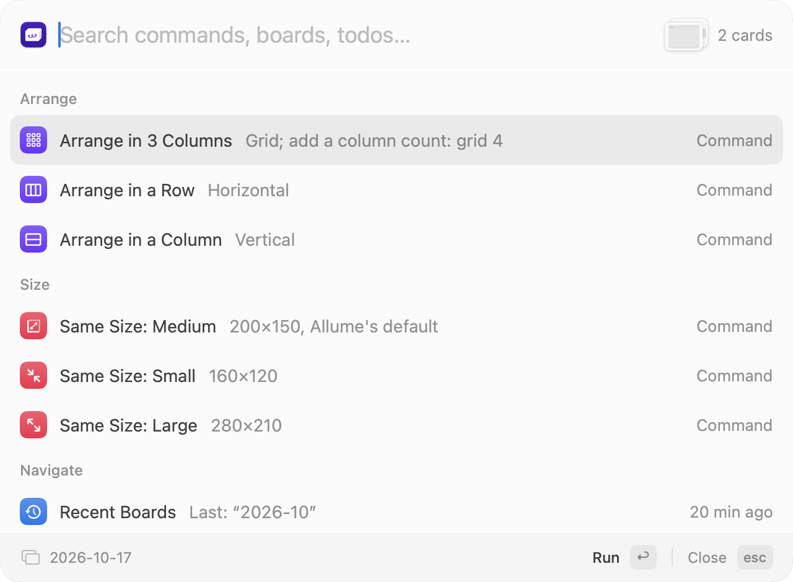

# Allume Companion

English | [中文](README.zh-CN.md)

A ⌘K command palette for [Allume](https://allume.com) (formerly Muse). Select some cards, press **⌘K**,
and tidy them up, jump to another board, jot down a todo or open today's note, all without leaving
the canvas.

<p align="center"></p>

## What it does

- **Arrange cards**: lay the selected cards out in a grid, a row or a column, in their current order,
  by title or by date.
- **Same size**: make the selected cards Small, Medium or Large in one go.
- **Jump anywhere**: type part of a board's name to open it, go back to a board you just visited, or
  head home to the top of your workspace.
- **Todos**: any text card that starts with `@todo` becomes a todo. See them all in one list, add a new
  one with a due date in plain words ("tomorrow", "Friday", "Oct 20"), mark it done or postpone it
  from the list, and get a reminder on the day.
- **Daily notes**: Today, Yesterday, Tomorrow and This Month open a board for that day or month,
  set up as a calendar for you.
- **Projects**: keep project boards in Todo / Doing / Done and move them along with one command.
- **Undo**: changed your mind about an arrangement? Undo puts the cards back.

Press Esc or ⌘K again, or click back into Allume, and the panel goes away. The rest of the time the
app waits quietly in the menu bar. It works with Allume in full screen and in Split View too; in a
narrow window the panel gets narrower.

The app is in English or Chinese, following your Mac's language.

## What you need

- macOS 14 or later
- Allume (from [allume.com](https://allume.com) or Setapp), with its command-line tool turned on (see below)

Tested with **Allume 4.0.2 (build 10836)**. The companion relies on a few things Allume doesn't document
(what it puts on the clipboard, its window title), so a later Allume update can break parts of it.
Settings → Allume shows the version it was tested with next to yours.

## Install

1. Download the latest `AllumeCompanion-<version>.zip` from
   [Releases](https://github.com/mmssddss/allume-companion/releases), unzip it and drag
   **AllumeCompanion.app** into Applications. It is signed and notarized by Apple.
2. Open it. The first time, macOS asks to give it **Accessibility** access (System Settings → Privacy &
   Security → Accessibility). Allow notifications too if you want todo reminders.
3. Turn on Allume's command-line tool:
   1. Open Allume, then go to Allume's **Settings → CLI** and install the command-line tool.
   2. In the same place, allow it to **write** (read-write). It starts out read-only, and then
      arranging, resizing and adding todos won't work.

If anything is still missing, the companion's settings window opens on its **Allume** tab and tells you
the next step. When all four rows there are green, you're set: press ⌘K in Allume.

## Using it

Press **⌘K** in Allume. With nothing typed, the panel shows what you can do with what is selected:

| You selected | You can |
|---|---|
| Nothing | Recent Boards, All Todos, Home, Today, Yesterday, Tomorrow, This Month, Add Todo, Add to Day, New Project |
| One card | Same Size: Small / Medium / Large; if it is a board, Open it |
| Several cards | Arrange in Columns, in a Row, in a Column; Same Size |
| A project | Mark Done, Move to Doing, Move to Todo |

Or just start typing. Commands, boards and todos are searched together, so `grid` finds the arrange
command and `trip` finds your "Japan trip" board. A number sets the columns (`grid 4`), and a few
words change the order: `row reverse`, `column by title`, `grid 2 by date`. Use ↑↓ to pick and Return
to run.

To delete cards, use Allume's own Delete key; Allume's ⌘Z brings them back.

## Todos

A todo is a text card whose first line starts with `@todo`. To give it a due date, write
`@todo(due: 2026-10-20) Pay rent`. When it's done, it becomes `@done` (from the list, or by hand).

- **All Todos** shows every todo in your workspace, overdue and due ones first. Press Return to go to
  its board, **⌘Return** to mark it done (`@todo` becomes `@done`; the card stays where it is),
  **⌥Return** to postpone it a day, or **⇧⌥Return** a week. A todo that is already overdue moves to
  tomorrow (or a week from today). Undo in the panel puts the card back as it was.
- **Add Todo** sticks a new todo card in the middle of what you're looking at. Put the date at the
  start or the end: `Pay rent Friday`, `tomorrow Call the bank`, `Renew passport Oct 20`.
- **Add to Day** puts the todo on that day's daily note instead, and you stay where you are.
- **Reminders**: on the due day you get a notification (at 9:00 by default; change it in Settings →
  Reminders). Click it to open the board.

## Daily notes and projects

The companion keeps everything it creates on one board of its own, **workspace-Companion**, on your
workspace's home board:

```
workspace-Companion
├─ Daily Notes › 2026 › 2026-10 › 2026-10-17
└─ Projects › Todo / Doing / Done › project-<name>
```

The first time you use one of these, the companion asks before it creates workspace-Companion. Opening
a day for the first time also sets up every month and day board of that year in the background (about
380 boards, a few minutes).

- **Today**, **Yesterday**, **Tomorrow** and **This Month** take you to that day's or month's board.
  Each month board lays its days out like a calendar.
- **New Project** creates a `project-…` board in Todo (or Doing; see Settings). Select a project, or
  open one, and use **Mark Done**, **Move to Doing** or **Move to Todo**. Everything on the board comes
  along.

It never changes boards outside workspace-Companion, apart from arranging and resizing the cards you
select, adding the todos you ask for, and changing the `@todo` line of a todo you mark done or postpone.

## Privacy

Everything stays on your Mac. The app makes no network requests. It works with Allume only through
Allume's own command-line tool. To find out which cards are selected, it copies them (⌘C) and then
puts your clipboard back. Allume's card data is in the clipboard for a few milliseconds, and the clipboard
it puts back is marked as [transient](http://nspasteboard.org), so clipboard managers such as Paste don't
list it as a new copy.

## Uninstall

1. If you turned on **Open at login** (Settings → General), turn it off. Then quit from the menu bar icon
   and move AllumeCompanion.app to the Trash.
2. Remove what it keeps on your Mac (the board index, todo list, visit history, thumbnails, the log and its
   settings):

   ```bash
   rm -rf ~/Library/Application\ Support/AllumeCompanion ~/Library/Logs/AllumeCompanion.log
   defaults delete com.maverickli.allume-companion
   ```
3. Remove it from System Settings → Privacy & Security → Accessibility.
4. In Allume, **workspace-Companion** stays with your daily notes and projects. Delete that board if you
   don't want them. Todos you added elsewhere are ordinary text cards and stay where they are.

## Feedback

Found a bug or have an idea? [Open an issue](https://github.com/mmssddss/allume-companion/issues).
For a bug, choose **Copy Diagnostics** in the menu bar (or Settings → Allume) and paste it into the issue:
versions, setup and the end of the log. Read it over first, since the log has board and card titles in it.
Building from source and how it works inside (in Chinese): [docs/DEVELOPMENT.md](docs/DEVELOPMENT.md).

## License

MIT, see [LICENSE](LICENSE). Made by [Maverick Li](https://maverickli.org). Allume is a product of
Muse Software. This project is not affiliated with it.
