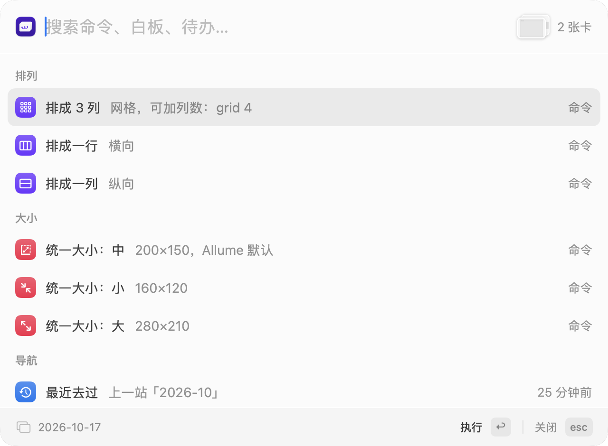

# Allume Companion

[English](README.md) | 中文

[Allume](https://allume.com)（原 Muse）的 ⌘K 命令面板。选中几张卡片，按 **⌘K**：排整齐、跳到别的白板、
记一条待办、打开今天的日记，都不用离开画布。

<p align="center"></p>

## 能做什么

- **排列卡片**：把选中的卡片排成网格、一行或一列，按现在的先后、按标题或按创建时间。
- **统一大小**：一次把选中的卡片都改成小、中或大。
- **到处跳**：输入白板名字的一部分就能打开它；回到刚才去过的白板；回到 workspace 的首页。
- **待办**：正文以 `@todo` 开头的文字卡就是待办。在一张列表里看全部待办；添加待办时用平常的说法写日期
  （"明天""下周二""月底"）；在列表里直接标完成或推迟；到期那天收到提醒。
- **日记**：今天、昨天、明天、本月，打开那一天或那个月的白板，按日历排好。
- **项目**：项目白板放在 Todo / Doing / Done 里，一条命令挪到下一格。
- **撤销**：排完不满意，撤销就把卡片放回原处。

按 Esc、再按一次 ⌘K 或点回 Allume，面板就收起来；平时它安静地待在菜单栏里。Allume 全屏或分屏时也能用，
窗口窄的时候面板跟着变窄。

界面有中文和英文，跟随 Mac 的系统语言。

## 需要

- macOS 14 或更新
- Allume（[allume.com](https://allume.com) 或 Setapp），并打开它的命令行工具（见下）

在 **Allume 4.0.2（build 10836）** 上测试过。Companion 用到了几处 Allume 没写进文档的行为（复制到剪贴板的内容、
窗口标题），Allume 以后升级可能让其中一部分失效。设置 → Allume 里会同时列出测试过的版本和你的版本。

## 安装

1. 在 [Releases](https://github.com/mmssddss/allume-companion/releases) 下载最新的 `AllumeCompanion-<版本>.zip`，
   解压后把 **AllumeCompanion.app** 拖进"应用程序"。已签名并经过 Apple 公证。
2. 打开它。第一次会请你给它**辅助功能**权限（系统设置 → 隐私与安全性 → 辅助功能）；想要待办提醒的话也允许通知。
3. 打开 Allume 的命令行工具：
   1. 打开 Allume，在 Allume 的**设置 → CLI** 里安装命令行工具。
   2. 同一个地方把它设成可以**写入**（read-write）。默认是只读的，那样排列、改大小、添加待办都做不了。

还缺什么的话，Companion 的设置窗口会打开在 **Allume** 页，告诉你下一步做什么。那一页四行都变绿就好了：在 Allume 里按 ⌘K。

## 怎么用

在 Allume 里按 **⌘K**。不输入时，面板列出对当前选中能做的事：

| 选中了 | 可以 |
|---|---|
| 什么都没选 | 最近去过、全部待办、回首页、今天、昨天、明天、本月、添加待办、记到某天、新建项目 |
| 一张卡 | 统一大小：小 / 中 / 大；如果是白板，还能打开它 |
| 几张卡 | 排成 N 列、排成一行、排成一列；统一大小 |
| 一个项目 | 完成、移到 Doing、移到 Todo |

也可以直接打字：命令、白板、待办一起搜，`排列` 找到排列命令，`旅行` 找到你的"日本旅行"白板。
数字是列数（`排成4列`、`grid 4`），再加几个字改顺序：`一行逆序`、`按标题一列`、`按时间排成2列`。
↑↓ 选，回车执行。

删除卡片用 Allume 自己的 Delete 键，Allume 的 ⌘Z 能撤回。

## 待办

正文第一行以 `@todo` 开头的文字卡就是待办。要到期日就写成 `@todo(due: 2026-10-20) 交房租`；做完变成 `@done`（在列表里标，或者手改）。

- **全部待办**：整个 workspace 的待办，过期和到期的排最前。回车跳到它所在的白板；**⌘回车**标记完成
  （`@todo` 变成 `@done`，卡片留在原处）；**⌥回车**推迟一天，**⇧⌥回车**推迟一周，已经过期的从今天算起。
  面板里的撤销能把卡片改回去。
- **添加待办**：在你眼前贴一张新的待办卡。日期写在开头或末尾：`下周二 交房租`、`交房租 月底`、`3天后 续护照`，
  打到一半按 Tab 补全。
- **记到某天**：把待办贴到那天的日记白板上，人不用跳过去。
- **提醒**：到期那天发一条通知（默认 9:00，在设置 → 提醒里改），点开就是那块白板。

## 日记与项目

Companion 新建的东西都放在它自己的一块白板 **workspace-Companion** 里，在 workspace 的首页上：

```
workspace-Companion
├─ Daily Notes › 2026 › 2026-10 › 2026-10-17
└─ Projects › Todo / Doing / Done › project-<名字>
```

第一次用到这些功能时，Companion 会先问你，再建 workspace-Companion。第一次打开某一天时，还会在后台把这一年的
月白板和每天的白板一次建好（约 380 块，要几分钟）。

- **今天**、**昨天**、**明天**、**本月**：去那一天或那个月的白板。月白板里的日子按日历排。
- **新建项目**：在 Todo（或 Doing，设置里改）里建一块 `project-…` 白板。选中一个项目，或者人在项目白板里，
  用**完成**、**移到 Doing**、**移到 Todo** 挪动它，白板里的东西原样跟着走。

除了排列、改大小你选中的卡片、贴上你要加的待办，以及改写你标完成或推迟的那条待办的 `@todo` 那一行，
它不会动 workspace-Companion 以外的白板。

## 隐私

所有东西都在你的 Mac 上，app 不联网。它只通过 Allume 自己的命令行工具操作 Allume；为了知道选中了哪些卡片，
它会复制一下（⌘C），然后把剪贴板还原。Allume 的卡片数据只在剪贴板里停几 ms；还原回去的内容带
[transient 标记](http://nspasteboard.org)，Paste 这类剪贴板管理器不会把它当成一次新的复制记下来。

## 卸载

1. 如果打开过**登录时自动打开**（设置 → 通用），先关掉。然后从菜单栏图标退出，把 AllumeCompanion.app 移到废纸篓。
2. 删掉它在 Mac 上存的东西（白板索引、待办列表、最近去过、缩略图、日志和设置）：

   ```bash
   rm -rf ~/Library/Application\ Support/AllumeCompanion ~/Library/Logs/AllumeCompanion.log
   defaults delete com.maverickli.allume-companion
   ```
3. 在系统设置 → 隐私与安全性 → 辅助功能里把它移除。
4. Allume 里的 **workspace-Companion** 会留着，里面是你的日记和项目；不要的话删掉这块白板。在别处添加的待办就是普通的
   文字卡片，留在原处。

## 反馈

发现问题或有想法，欢迎[提 issue](https://github.com/mmssddss/allume-companion/issues)。
报 bug 时请在菜单栏（或设置 → Allume）点**复制诊断信息**，贴进 issue：里面有版本、设置和日志的最后一段。
贴之前看一遍，日志里有白板和卡片的标题。
从源码构建和内部原理见 [docs/DEVELOPMENT.md](docs/DEVELOPMENT.md)。

## 协议

MIT，见 [LICENSE](LICENSE)。作者 [Maverick Li](https://maverickli.org)。Allume 是 Muse Software 的产品，本项目与其无关。
